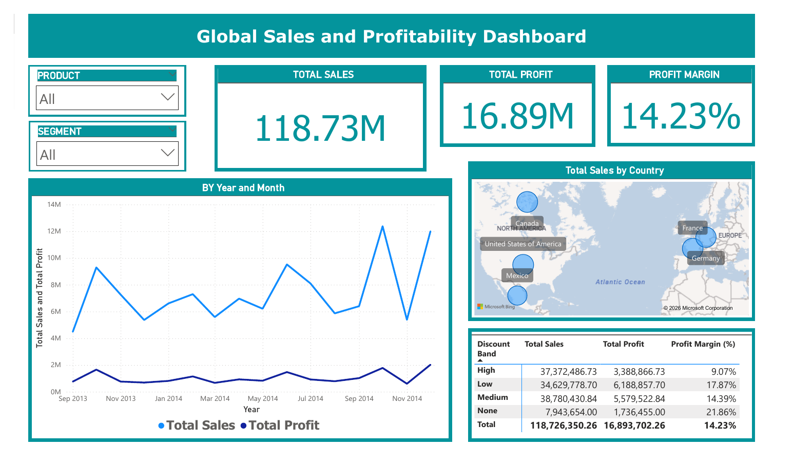
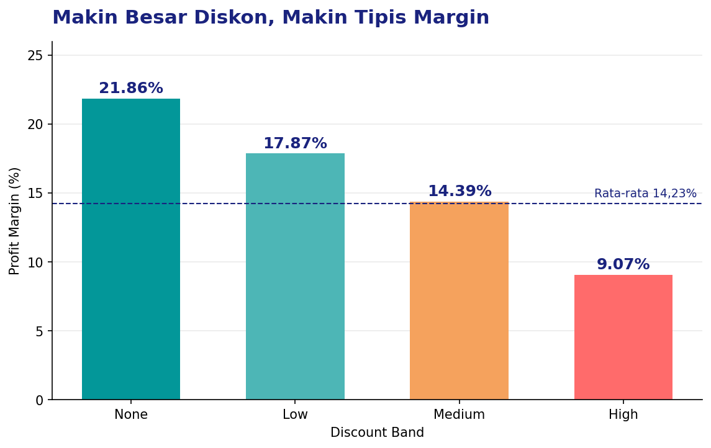
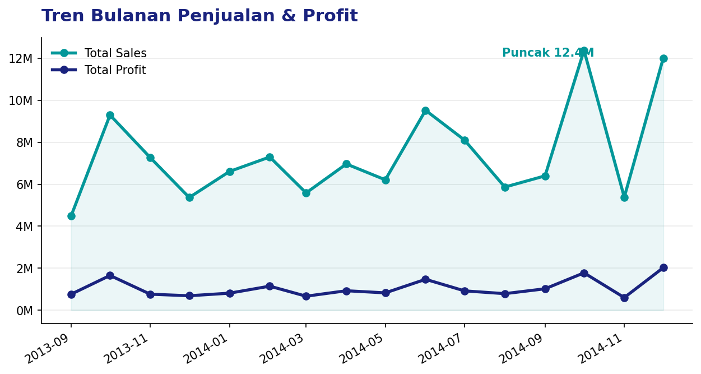
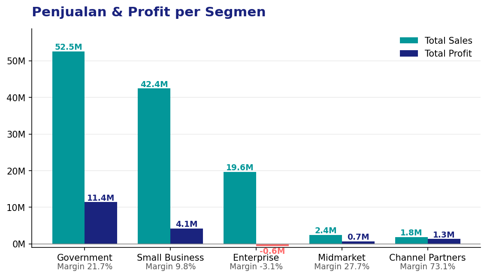
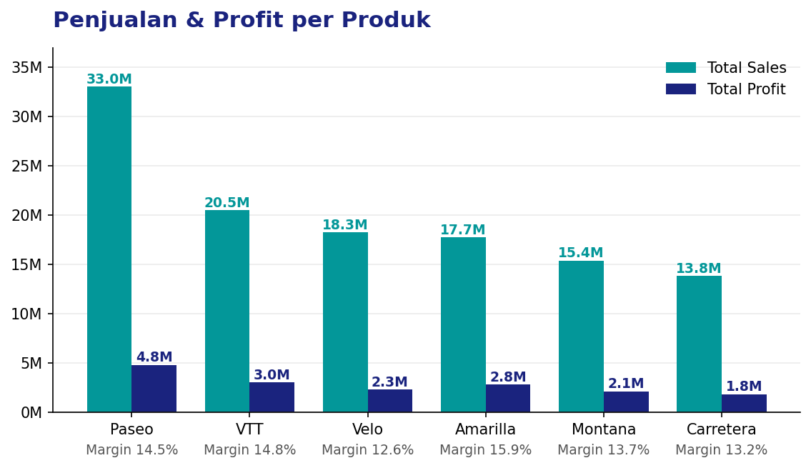
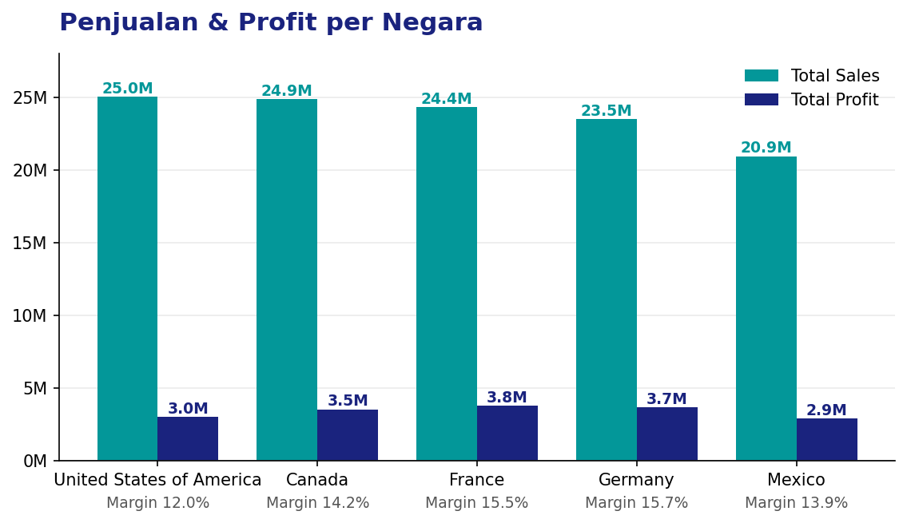

<div align="center">

# 📊 Global Sales and Profitability Dashboard
### Tugas Mata Kuliah Business Intelligence


</div>

---

## 📌 Ringkasan

Proyek ini adalah tugas mata kuliah **Business Intelligence** yang diusulkan oleh **Bp. Agus Nugraha, S.T., M.Kom.**

Tujuannya adalah membangun dashboard **Power BI** yang menjawab pertanyaan dasar bisnis: **berapa penjualan dan keuntungan perusahaan, dari mana asalnya, dan seberapa besar diskon menggerus profit?**



---

## 🎯 Tujuan

1. Menampilkan indikator kinerja utama (KPI): total penjualan, total profit, dan profit margin.
2. Melihat tren penjualan dan profit dari bulan ke bulan.
3. Memetakan penjualan berdasarkan negara.
4. Membandingkan profitabilitas pada tiap tingkat diskon.
5. Menyediakan filter interaktif berdasarkan produk dan segmen.

---

## 📈 Hasil Utama

| Indikator | Nilai |
|---|---:|
| **Total Sales** | **118,73 juta** |
| **Total Profit** | **16,89 juta** |
| **Profit Margin** | **14,23%** |

### Profitabilitas per Tingkat Diskon



| Discount Band | Total Sales | Total Profit | Profit Margin |
|---|---:|---:|---:|
| None | 7.943.654 | 1.736.455 | **21,86%** |
| Low | 34.629.779 | 6.188.858 | 17,87% |
| Medium | 38.780.431 | 5.579.523 | 14,39% |
| High | 37.372.487 | 3.388.867 | **9,07%** |
| **Total** | **118.726.350** | **16.893.702** | **14,23%** |

**1. Makin besar diskon, makin tipis margin.** Margin turun dari 21,86% (tanpa diskon) menjadi 9,07% (diskon tinggi). Band High menyumbang penjualan hampir setara Medium, tetapi profitnya sekitar 39% lebih rendah.

---

### Tren Bulanan



**2. Tren fluktuatif dengan puncak di Oktober 2014** (sekitar 12,4 juta). Penjualan dan profit bergerak searah, tetapi profit selalu jauh di bawah penjualan.

---

### Analisis per Segmen



**3. Government paling dominan.** Penjualannya 52,5 juta dengan margin 21,7%. **Enterprise merugi** (profit −0,6 juta, margin −3,1%) meski penjualannya 19,6 juta. Channel Partners dan Midmarket kecil dalam volume, tetapi margin-nya tertinggi (73,1% dan 27,7%).

---

### Analisis per Produk



**4. Paseo produk terlaris** dengan penjualan 33,0 juta, lebih dari dua kali lipat Carretera yang terendah (13,8 juta). Margin antar produk cukup berdekatan (12,6% sampai 15,9%). Amarilla paling efisien, sedangkan Velo paling rendah.

---

### Analisis per Negara



**5. Penjualan merata di lima negara** (21–25 juta). Amerika Serikat tertinggi dalam penjualan (25,0 juta), tetapi margin-nya paling rendah (12,0%). Jerman (15,7%) dan Prancis (15,5%) paling menguntungkan.

> 📝 Grafik di bagian ini dibuat dari data `Sample data praktikum 1.xlsx` dengan Python (matplotlib). Dashboard Power BI aslinya belum memuat visual per segmen, produk, dan negara. Panduan menambahkannya ada di bagian **Menambah Visual di Power BI**.

### 💡 Saran

- Evaluasi kebijakan **diskon tinggi**, karena memangkas margin lebih dari separuh dibanding penjualan tanpa diskon.
- Telusuri penyebab **kerugian segmen Enterprise**, misalnya harga, diskon, atau biaya produksi.
- Pertahankan segmen **Government** sebagai penopang profit.

---

## 🗂️ Dataset

**File:** `Sample data praktikum 1.xlsx` (sampel data praktikum)

| Atribut | Keterangan |
|---|---|
| Jumlah baris | 700 transaksi |
| Jumlah kolom | 16 |
| Periode | September 2013 – Desember 2014 |
| Segmen | Government, Midmarket, Channel Partners, Enterprise, Small Business |
| Negara | Canada, France, Germany, Mexico, United States of America |
| Produk | Carretera, Montana, Paseo, Velo, VTT, Amarilla |
| Discount Band | None, Low, Medium, High |

**Kolom:** `Segment`, `Country`, `Product`, `Discount Band`, `Units Sold`, `Manufacturing Price`, `Sale Price`, `Gross Sales`, `Discounts`, `Sales`, `COGS`, `Profit`, `Date`, `Month Number`, `Month Name`, `Year`.

> **Catatan:** nilai `None` pada kolom `Discount Band` adalah kategori sah (tanpa diskon), bukan data kosong. Beberapa aplikasi, termasuk pandas, membacanya sebagai nilai kosong secara tidak sengaja.

---

## 🧮 Ukuran (Measure) di Power BI

| Measure | Fungsi |
|---|---|
| `Total Sales` | Jumlah penjualan |
| `Total Profit` | Jumlah keuntungan |
| `Profit Margin (%)` | Total Profit dibagi Total Sales |

Model data juga memakai tabel **Calendar Table** untuk analisis waktu.

---

## 📊 Komponen Dashboard

| Visual | Fungsi |
|---|---|
| Slicer **Product** dan **Segment** | Filter interaktif |
| Kartu **Total Sales**, **Total Profit**, **Profit Margin** | Ringkasan KPI |
| Line chart **By Year and Month** | Tren penjualan dan profit bulanan |
| Peta **Total Sales by Country** | Sebaran penjualan per negara |
| Tabel **Discount Band** | Penjualan, profit, dan margin per tingkat diskon |

---

## ➕ Menambah Visual di Power BI

Untuk menampilkan analisis di atas langsung di dashboard:

| Visual | Jenis | Sumbu / Nilai |
|---|---|---|
| Per Segmen | Clustered column chart | Sumbu: `Segment`, Nilai: `Total Sales`, `Total Profit` |
| Per Produk | Clustered column chart | Sumbu: `Product`, Nilai: `Total Sales`, `Total Profit` |
| Margin per Diskon | Column chart | Sumbu: `Discount Band`, Nilai: `Profit Margin (%)` |

Contoh measure DAX untuk margin (jika belum ada):

```dax
Profit Margin (%) = DIVIDE ( [Total Profit], [Total Sales] ) * 100
```

---

## 🧰 Teknologi

- **Microsoft Power BI Desktop** untuk pemodelan dan visualisasi
- **DAX** untuk measure dan tabel kalender
- **Microsoft Excel** sebagai sumber data

---

## 📁 Struktur Repositori

```
Tugas-Business-Intelligence/
├── assets/
│   ├── dashboard-preview.png          # Pratinjau dashboard
│   ├── chart-segment.png              # Analisis per segmen
│   ├── chart-product.png              # Analisis per produk
│   ├── chart-country.png              # Analisis per negara
│   ├── chart-discount.png             # Margin per tingkat diskon
│   └── chart-trend.png                # Tren bulanan
├── Sample data praktikum 1.xlsx       # Dataset
├── Tugas Bussines Intelegence.pbix    # File dashboard Power BI
├── Tugas Bussines Intelegence.pdf     # Hasil dashboard (PDF)
└── README.md
```

---

## 🚀 Cara Menjalankan

1. **Clone repositori**
   ```bash
   git clone https://github.com/ashafamultazam/Tugas-Business-Intelligence.git
   cd Tugas-Business-Intelligence
   ```
2. **Install Power BI Desktop** (gratis, hanya untuk Windows).
3. **Buka** `Tugas Bussines Intelegence.pbix`.
4. Jika sumber data tidak ditemukan, arahkan ke file Excel di folder ini lewat **Transform data → Data source settings**.
5. Gunakan slicer **Product** dan **Segment** untuk menjelajahi data.

Tanpa Power BI, lihat hasilnya di `Tugas Bussines Intelegence.pdf`.

---

## ⚠️ Keterbatasan

- Data hanya **700 baris** dalam **16 bulan**, sehingga tren jangka panjang tidak dapat disimpulkan.
- Dataset berupa **data latihan**, bukan data bisnis riil.
- Hubungan diskon dan margin adalah **korelasi**, bukan bukti sebab-akibat.
- Satuan mata uang tidak disebutkan pada data.

---

## 👤 Penulis

**Asha Fa Multazam** — [GitHub](https://github.com/ashafamultazam)

Dosen pengampu: **Bp. Agus Nugraha, S.T., M.Kom.**

---

<div align="center">

⭐ Jika proyek ini bermanfaat, beri bintang pada repositori ini.

</div>
